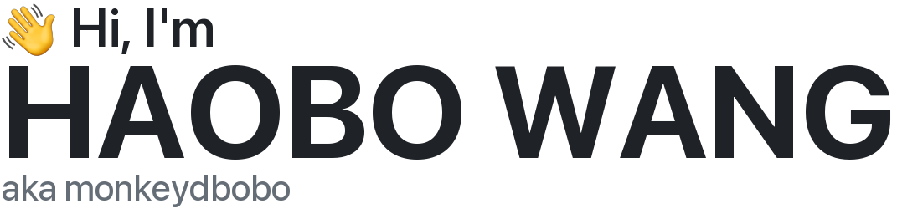

<!-- author: wanghaobo -->

<picture>
  <source media="(prefers-color-scheme: dark)" srcset="assets/hello-dark.png">
  
</picture>

<strong>English</strong>

I work at [StreamLake](https://www.streamlake.ai/), Kuaishou. I'm a **full-stack engineer** from video systems. Players, delivery, and client infrastructure are the foundation. AI video products are where that foundation ships.

🤖 I'm an **AI agent** enthusiast. I like agents that can take a job all the way through, and I spend time on how they actually work.

I care about two things: getting the implementation right, and putting it in front of people who will use it. The value of the work shows up in the **product** and in the **business**.

### 🎬 Now

**✂️ [CyberCut](https://cybercut.ai)** · [Product Hunt](https://www.producthunt.com/products/cybercut)

An AI video studio for social clips. In December 2025 it was **#1 Product of the Day, the Week, and the Month**, and #1 of the month in Artificial Intelligence and Marketing. I built the product's frontend and backend, with the architecture centered on the **backend**: long-to-short clips, marketing videos, captions, and the pipeline that turns source material into something ready to publish.

&nbsp;

&nbsp;

**🎞️ [oioi.bio](http://oioi.bio)**

A personal full-stack project. A narrative filmmaking workspace that takes an idea or a novel through script, cast, locations, and storyboard, then into video.

### 📺 Before

Years in audio and video clients and infrastructure:

- Players on Android, iOS, C++, and FFmpeg
- PCDN client technology
- Android client infrastructure
- **Compilation and build systems**, from native code to a client that ships

Same line of work. Earlier I made video play and travel reliably. Now I make the video itself, and get it into a creator's hands.

### 🦀 Open source

Merged into the **Rust compiler**: [rust-lang/rust#130781](https://github.com/rust-lang/rust/pull/130781). On macOS, `strip = true` in Cargo could pick up GNU `strip` from `PATH` and break build scripts. The change points Darwin at the right `strip`.

### 🤝 Collaboration

I like building with product, design, business, and engineering in the same room. Different jobs, one outcome: something that ships, gets used, and holds up as a business.

<strong>中文</strong>

我在快手的 [StreamLake](https://www.streamlake.ai/) 工作，是从音视频系统出来的**全栈工程师**。播放器、分发和客户端基础架构是底子。AI 视频产品是这套底子现在交付的地方。

🤖 我是 **AI agent** 狂热爱好者。我喜欢能把一件事做完的 agent，也会花时间弄清它们到底怎么工作。

我在意两件事：实现要做对，而且要交到会用的人手里。工作的价值，体现在**产品**和**商业**里。

### 🎬 现在

**✂️ [CyberCut](https://cybercut.ai)** · [Product Hunt](https://www.producthunt.com/products/cybercut)

面向社交传播的 AI 视频工作室。2025 年 12 月，它在 Product Hunt 拿下**日榜、周榜、月榜第一**，Artificial Intelligence 和 Marketing 两个品类也是当月第一。我做了产品的前后端能力，架构重心在**后端**：长视频切片、营销视频、字幕，以及从素材到可发布成片的链路。

&nbsp;

&nbsp;

**🎞️ [oioi.bio](http://oioi.bio)**

个人全栈项目。一个叙事影像工作台：从想法或小说出发，经过剧本、角色、场景和分镜，再到视频。

### 📺 以前

音视频客户端和基础架构做了很多年：

- 播放器：Android、iOS、C++、FFmpeg
- PCDN 客户端
- Android 客户端基础架构
- **编译和构建系统**，从原生代码到能发出去的客户端

同一条线。以前把视频播稳、传稳。现在把视频做出来，交到创作者手里。

### 🦀 开源

给 **Rust 编译器**合入过修复：[rust-lang/rust#130781](https://github.com/rust-lang/rust/pull/130781)。macOS 上 Cargo 配置 `strip = true` 时，会用到 PATH 里的 GNU `strip`，构建脚本因此失败。这个改动让 Darwin 使用正确的 strip。

### 🤝 合作

我喜欢和产品、设计、商业、工程坐在一起做事。职责不同，结果是同一个：做出来，有人用，也站得住商业价值。

